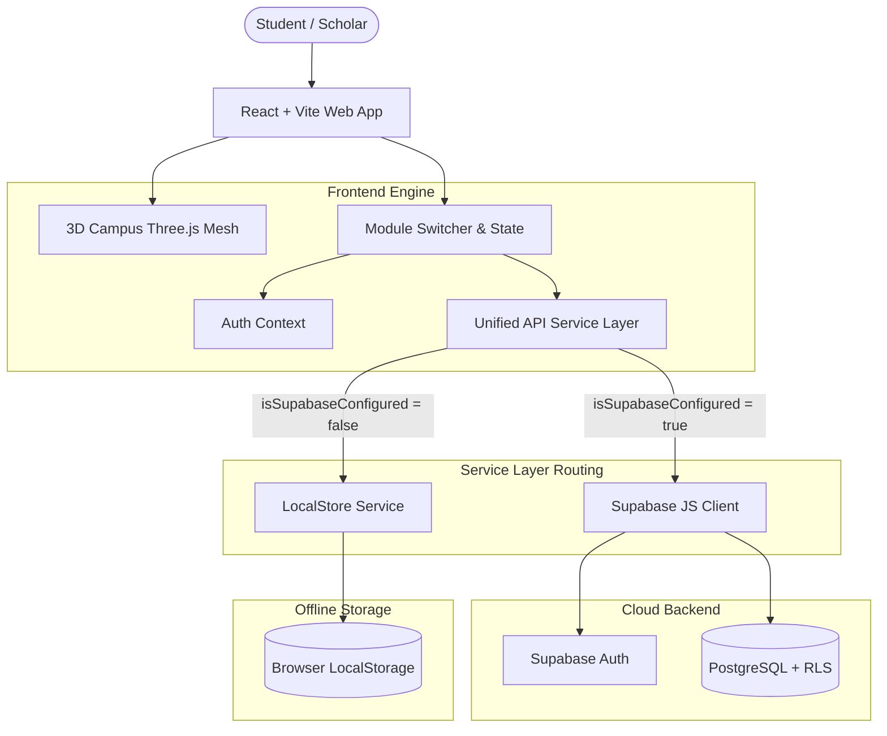

# SANKALP — An Integrated 3D Smart Campus Ecosystem

[]()
[]()
[]()
[]()
[]()
[]()

> **SANKALP** is a production-grade, futuristic web platform designed for college and university students. It unifies academic tracking, productivity tools, AI-powered study synthesizers, interactive 3D concept visualization, coding practice, and student welfare into one responsive dashboard.

---

## 🌟 Key Highlights & Engineering Features

- **Futuristic 3D Connected Campus Hero**: Powered by Three.js, React Three Fiber, and Drei, featuring an animated cyber core with orbiting module nodes, glowing connection beams, floating particles, and an automatic lightweight 2D SVG fallback for low-power mobile devices.
- **Dual-Mode Persistence Architecture**:
  - **Live Supabase Connected Mode**: Real Supabase Authentication, PostgreSQL database, and Row Level Security (RLS) policies ensuring each student's records are completely isolated and private.
  - **Persistent Local Demo Mode**: Instant zero-configuration evaluation mode with pre-populated academic datasets stored in `localStorage` across reloads without requiring immediate cloud credentials.
- **8 Fully Implemented Engineering Modules**:
  1. 💰 **Expense Tracker**: Category expenditure breakdown (Recharts Donut/Bar charts), monthly budget progress bar, transaction history, filters, and CRUD.
  2. 📅 **Attendance Manager**: Daily attendance logger, **strict duplicate prevention** for identical subject & date, course eligibility calculation (`(Present / Total) * 100`), and target recovery formula: $\lceil \frac{T \cdot N - 100 \cdot P}{100 - T} \rceil$.
  3. 🧠 **AI Note Summarizer**: Upload text files (`.txt`, `.md`), generate executive summaries, key revision takeaways, and actionable study steps via Gemini 1.5 Flash API or the built-in offline extractive NLP heuristic.
  4. 📐 **Notes, Diagrams & Visuals**: Live reactive Mermaid diagram studio (Flowcharts, Sequence Diagrams, Class Diagrams, State Machines) with zoom/reset controls and instant SVG export.
  5. 🃏 **3D Flashcards & Spaced Repetition**: Realistic 3D flip card animations, study session mode, Easy/Good/Hard rating system, and confetti milestone celebrations.
  6. 🎙️ **Text-to-Speech Lecture Reader**: 100% private, client-side SpeechSynthesis audio player with system voice enumeration, rate (0.5x - 2.0x), and pitch sliders.
  7. 💻 **Monaco Code Editor & Sandbox**: Full syntax highlighting for JavaScript, Python, C, C++, and HTML with client-side sandbox execution and clear container isolation notices.
  8. 🛡️ **Student Safety & Welfare**: 24/7 verified institutional hotlines (National 112, Campus Security HQ, Clinic & Ambulance, Counseling Center, Anti-Ragging Cell, Women's Safety Cell), one-click emergency SOS beacon with audio alerts, and personal guardian contact management.

---

## 📐 System Architecture



---

## 🚀 Quick Start Guide

### Prerequisites
- Node.js `v18+` or `v20+` (tested on Node v24)
- npm `v9+` or `v11+`

### 1. Clone & Install Dependencies
```bash
# Navigate to the project root
cd SANKALP_SMART_CAMPUS_ECOSYTEM

# Install dependencies
npm install --legacy-peer-deps
```

### 2. Configure Environment Variables (Optional)
Copy the template `.env.example` to `.env`:
```bash
cp .env.example .env
```
Fill in your credentials (leave blank to run in instant Demo Mode):
```env
# Supabase Project Credentials
VITE_SUPABASE_URL=https://your-project.supabase.co
VITE_SUPABASE_ANON_KEY=eyJhbGciOiJIUzI1NiIsInR5cCI6IkpXVCJ9...

# Optional: Google Gemini API Key for Neural Summaries
VITE_GEMINI_API_KEY=AIzaSy...
```

### 3. Run Development Server
```bash
npm run dev
```
Open **[http://localhost:5173](http://localhost:5173)** in your browser.

### 4. Run Automated Vitest Test Suite
```bash
npm run test
```

### 5. Build for Production
```bash
npm run build
```

---

## 🗄️ Supabase Database Architecture & RLS Migration

All SQL migration scripts are located in:
[`supabase/migrations/20261029000000_sankalp_schema.sql`](supabase/migrations/20261029000000_sankalp_schema.sql)

### Tables Schema Overview

| Table | Primary Key | Foreign Key | Purpose | RLS Policy |
| :--- | :--- | :--- | :--- | :--- |
| `profiles` | `id (UUID)` | `auth.users(id)` | Student profile metadata | `auth.uid() = id` |
| `budgets` | `id (UUID)` | `auth.users(id)` | Monthly budget limits | `auth.uid() = user_id` |
| `expenses` | `id (UUID)` | `auth.users(id)` | Logged student spending | `auth.uid() = user_id` |
| `subjects` | `id (UUID)` | `auth.users(id)` | Enrolled course registry | `auth.uid() = user_id` |
| `attendance_records` | `id (UUID)` | `auth.users(id), subjects(id)` | Daily attendance logs (Unique: user, subject, date) | `auth.uid() = user_id` |
| `notes` | `id (UUID)` | `auth.users(id)` | Original notes & AI summaries | `auth.uid() = user_id` |
| `diagrams` | `id (UUID)` | `auth.users(id)` | Mermaid visuals & flowcharts | `auth.uid() = user_id` |
| `flashcards` | `id (UUID)` | `auth.users(id)` | Q&A cards & review counters | `auth.uid() = user_id` |
| `flashcard_reviews` | `id (UUID)` | `auth.users(id), flashcards(id)` | Spaced-repetition history | `auth.uid() = user_id` |
| `code_snippets` | `id (UUID)` | `auth.users(id)` | Code files and script tags | `auth.uid() = user_id` |
| `safety_resources` | `id (UUID)` | `auth.users(id) (nullable)` | Campus hotlines & personal contacts | Institutional: Public Read; Personal: `auth.uid() = user_id` |

### Setting Up in Supabase Dashboard:
1. Log in to [Supabase](https://supabase.com) and create a project named `sankalp-smart-campus`.
2. Open the **SQL Editor** in your Supabase dashboard.
3. Paste the contents of `supabase/migrations/20261029000000_sankalp_schema.sql` and click **Run**.
4. Go to **Project Settings -> API** and copy the **Project URL** and **anon public key**.
5. Paste them into `.env` as `VITE_SUPABASE_URL` and `VITE_SUPABASE_ANON_KEY`.

---

## 🧪 Testing and Quality Assurance

Automated tests are written with **Vitest** and **React Testing Library**:
```bash
npm run test
```

### Verified Test Cases:
- `src/test/attendance.test.ts`:
  - Validates overall and subject-wise percentage calculation: `(P / Total) * 100`.
  - Validates target recovery calculation: calculates exact consecutive classes needed to return above the minimum percentage threshold.
  - Validates **duplicate attendance prevention**: upserts rather than duplicates entries for the same subject and calendar date.
- `src/test/expenses.test.ts`:
  - Validates monthly budget tracking, addition, category updates, and deletion.
- `src/test/auth.test.ts`:
  - Validates student profile updates and multi-student data separation.
  - Validates institutional resource protection: guarantees official emergency numbers cannot be removed by individual students.

---

## 📱 Accessibility & Responsive Design

- **High Contrast Theme**: Tested for WCAG 2.1 AA contrast standards using electric blue (`#38bdf8`), cyan (`#06b6d4`), and dark navy (`#070b14`).
- **Reduced Motion Support**: Animations respect OS-level reduced motion preferences.
- **Responsive Layout**: Designed for seamless operation on Desktop, Laptops, Tablets, and Mobile viewports with bottom navigation drawer.
- **Graceful WebGL Fallback**: If a device lacks GPU WebGL support, SANKALP automatically switches to an optimized SVG orbital animation without crashing.

---

## 🔒 Security Compliance

1. **Zero Secret Exposure**: Only the Supabase anonymous client key is used in frontend variables; service-role keys are strictly excluded.
2. **PostgreSQL RLS**: All user tables enforce database-level Row Level Security; unauthorized cross-student queries return 0 rows.
3. **Client-Side Code Execution Isolation**: JavaScript is evaluated in a sandboxed Function scope with captured console channels; compiled languages clearly state backend container isolation requirements.
4. **Private Speech Synthesis**: Uses the device's native browser SpeechSynthesis engine; student notes are never sent to third-party transcription services.

---

## 📄 License
Designed and engineered for university scholars and smart campus automation. Distributed under the MIT License.
